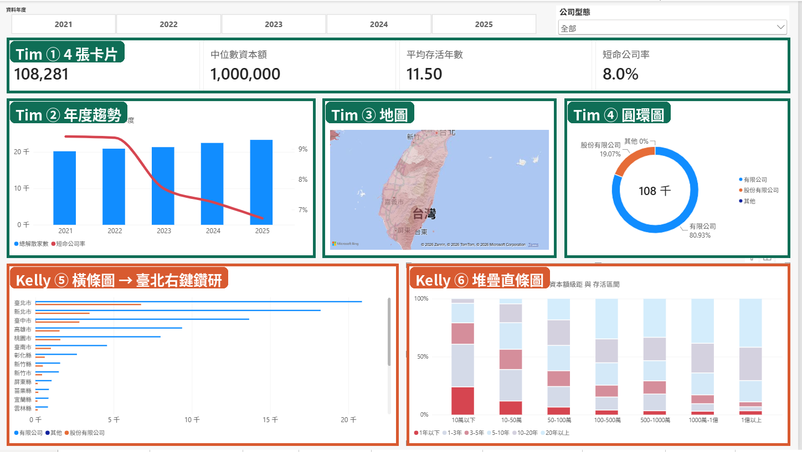
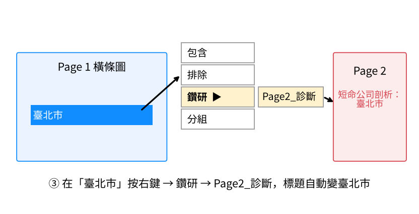
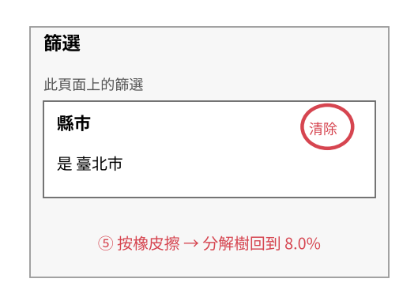
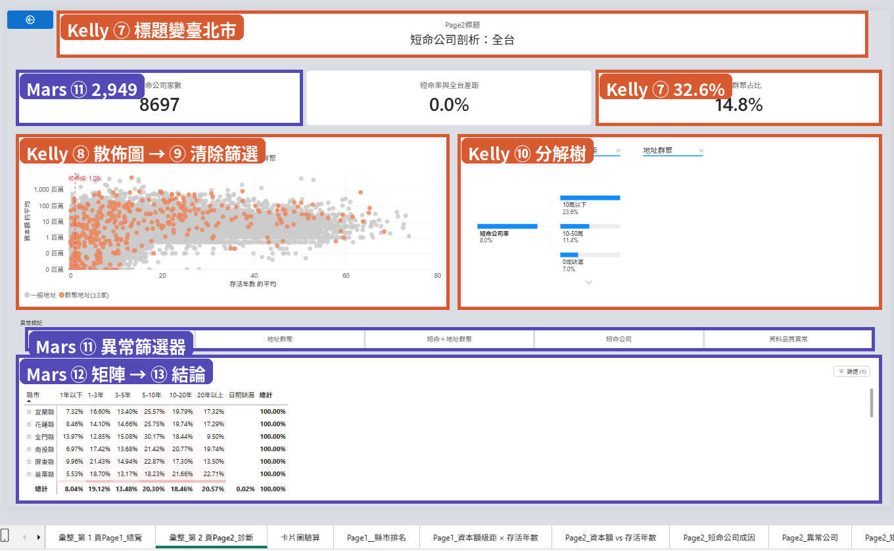

# 全組上台逐字稿（圖文對照）

> 對應彙整版畫面｜作戰手冊 V14｜🟢 Tim 0:00–1:30｜🟠 Kelly 1:30–3:30｜🟣 Mars 3:30–5:00
>
> 圈號是講的順序，講的人自己操作滑鼠。開場前：所有篩選器都不選、Page 2 標題是「全台」、停在 Page 1。

## Page 1｜誰講哪裡

## 🟢 Tim｜0:00–1:30

**開場**（不用指圖）

「各位好，我們這組分析的是經濟部 2021 到 2025 年的公司解散登記清冊，60 個月、共 10 萬 8,281 家公司。我們想回答一個問題：**什麼樣的公司最容易在一年內就解散？**先用敘述性分析看現況，再用診斷性分析找原因。」

**① 4 張卡片**：滑鼠由左到右停在卡片上

「5 年共解散 108,281 家。解散公司的資本額中位數只有 100 萬，平均存活 11.5 年，但有 8% 活不到一年，這就是我們說的『短命公司』。」

**② 5年解散家數與短命率**：先指藍色直條，再指紅色折線

「趨勢很有意思：解散家數從 2021 年 20,201 家增加到 2025 年 23,335 家，多了 15.5%；但短命公司的比例從 9.4% 降到 6.7%。解散的公司變多，但『開了馬上關』的比例變少。」

**③ 短命公司分布圖**：指地圖顏色最深的區域

「地圖顏色越深，代表短命公司的比例越高。」

**④ 解散公司型態**：點「有限公司」扇區，再點一次取消

「解散的公司有 8 成是規模較小的有限公司，這個比例 5 年都沒變。接下來請 Kelly 帶大家看，哪些公司最容易短命。」

> [!WARNING]
> 點完圓環圖一定要再點一次取消，否則 Kelly 的圖會只剩有限公司。→ 把滑鼠交給 Kelly。

## 🟠 Kelly｜1:30–3:30（Page 1）

**⑤ 各縣市解散家數**：滑鼠移到「臺北市」，停住讓提示框出現

「看縣市，臺北市 27,616 家解散最多。但家數多不代表風險高，滑鼠停上去看短命率，臺北是 8.2%；六都裡反而是臺中 9.7% 最高。」

**⑥ 資本額級距 × 存活年數**：先指「10萬以下」的紅色區塊，再指「100-500萬」

「真正拉開差距的是資本額。紅色是存活不到一年：資本額 10 萬以下的公司短命率 23.6%，100 到 500 萬的只有 3.6%，差了 6 倍。」

## 鑽研怎麼操作

**鑽研是什麼**：在 Page 1 點一個縣市，帶著這個縣市跳到 Page 2，Page 2 整頁只顯示這個縣市的資料，標題也會自動變成縣市名稱。

**進入（Kelly ⑦）**

1. 滑鼠移到橫條圖「臺北市」的長條上，等提示框出現。
2. 按**右鍵** → **鑽研** → **Page2_診斷**。
3. 畫面跳到 Page 2，標題變成「短命公司剖析：臺北市」。

**結束（Kelly ⑨）**：右側篩選窗格（或點畫布空白處後，視覺效果窗格的「鑽研」區塊）→ `縣市`「臺北市」→ 按**橡皮擦**。

> [!CAUTION]
> 不要按 ✕（會把鑽研欄位刪掉），也不要用「上一頁」按鈕回 Page 1 再切回來（臺北市篩選會留著，分解樹會變 8.2%）。

**右鍵沒有「鑽研」時**：① 橫條圖的工具提示類型要是「預設」 ② 放大畫面再按 ③ Page 2 的鑽研區塊要有 `縣市` ④ Page 2「允許用作工具提示」要關。台上真的點不出來，就直接點 Page 2 頁籤，說「我們直接看全台」，跳過 ⑦⑨。

編輯畫面按 Page 2 左上角「←」要用 **Ctrl + 點擊**；上台用不到這個按鈕。

## Page 2｜誰講哪裡

## 🟠 Kelly｜Page 2

**⑦ 鑽研進來**：指標題，再指右上角「地址群聚占比」卡片

「我們從臺北市鑽研進 Page 2，標題自動變成臺北市。右上角卡片顯示，臺北的解散公司有 32.6% 登記在『群聚地址』，也就是同一個地址有 3 家以上公司解散。」

**⑧ 散佈圖**：圈出短命線左側、下方的點

「散佈圖一個點是一家公司。短命線左邊的點，大多擠在底部小資本區，而且橘色的群聚地址特別多。」

**⑨ 清除臺北篩選**：照上面「鑽研怎麼操作」按橡皮擦，確認標題變回「全台」

「接下來看全台。」

**⑩ 分解樹**：開檔時「資本額級距」已展開 → 點「10萬以下」旁的「+」→ 地址群聚（只看到根節點時，先點根節點「+」→ 資本額級距）

「用分解樹把兩個因素疊起來。全台短命率 8%；資本額 10 萬以下跳到 23.6%；如果又登記在群聚地址，短命率是 **37.5%**，將近三家有一家活不到一年。同樣小資本但在一般地址的是 17.7%，差了一倍。接下來交給 Mars。」

→ 把滑鼠交給 Mars。

## 🟣 Mars｜3:30–5:00

**⑪ 異常標記篩選器**：點「短命＋地址群聚」，指左上「短命公司家數」卡片

「同時符合短命和地址群聚的有 2,949 家。整份清冊裡，同一地址解散最多的在臺北市大安區，一個地址 5 年內就有 85 家公司解散。」

→ 再點一次「短命＋地址群聚」取消。

**⑫ 矩陣熱力圖**：展開「臺北市」的 +，指「行銷」那一列的「1年以下」

「產業也有差異。名稱有『行銷』、『餐飲』的公司短命率約 13%，中位數只活 3.5 年左右；『建設』只有 3.9%。展開臺北市，『1年以下』那欄比例最高的是『行銷』，13.9%。」

> [!WARNING]
> 矩陣依縣市名稱排序，臺北市在很下面，要先捲動才找得到。彩排時先確認位置，或討論後改成只顯示六都。

**⑬ 結論**（不用操作）

「結論有三點。第一，解散家數逐年增加，但短命比例下降、解散公司的中位存活年數從 6.4 年拉長到 7.5 年，代表退場的多是經營較久的公司。第二，短命公司集中在小資本加群聚地址；公司法沒有最低資本額門檻，群聚地址可能是商務中心或代辦登記地址，反映『先登記再說』的試水溫型創業，這是我們的推論。第三，小資本加群聚地址可以當成風險訊號，給主管機關或銀行排核查優先順序。另外資料品質上，有 1,067 筆資本額為 0、地址或設立日期缺漏，我們已經標記出來。謝謝大家。」

## 備用問答（誰做的圖誰回答）

- 🟢 **Tim｜短命率為什麼下降？**「下降主要發生在群聚地址：群聚地址的短命率從 2021 年 24.4% 降到 2025 年 13.5%。原因資料裡看不出來，需要外部資料驗證。」
- 🟠 **Kelly｜金門短命率最高？**「金門 5 年只有 179 家，樣本太少，所以沒有拿來下結論；六都裡臺中市 9.7% 最高。」
- 🟠 **Kelly｜為什麼不算解散率？**「這份清冊只有解散的公司，沒有各縣市的公司總數，所以我們改比較『短命率』，它不受各縣市公司多寡影響。」
- 🟣 **Mars｜產業怎麼分的？**「用公司名稱關鍵字，有 6 成公司名稱沒有關鍵字，歸在『其他』，這是限制。」

## 上台前檢查

- 所有篩選器都沒有選取（年度、公司型態、異常標記）
- Page 2 標題是「全台」、分解樹收回根節點
- 沒有圖被點選（例如某一年直條變深色）
- 停在 Page 1

## 數字驗算（對照彙整版 V2，用 60 個 CSV 重算）

短命公司＝從設立到解散不滿 1 年（存活年數 < 1）。全台 **8,697 家 ÷ 108,281 家 ≈ 8.0%**。25 家缺設立日期，不算短命但仍算在分母。

| 拆法 | 明細 | 合計 |
| --- | --- | --- |
| 年度 | 2021：1,901（9.4%）、2022：1,960（9.4%）、2023：1,641（7.7%）、2024：1,629（7.2%）、2025：1,566（6.7%） | 8,697 |
| 地址 | 群聚地址 2,949 ＋ 一般地址 5,748 | 8,697 |
| 公司型態 | 有限公司 7,255（8.3%）＋ 股份有限公司 1,442（7.0%） | 8,697 |

| 六都 | 短命家數 | 總家數 | 短命率 |
| --- | --- | --- | --- |
| 臺北市 | 2,255 | 27,616 | 8.2% |
| 臺中市 | 1,596 | 16,465 | 9.7%（最高） |
| 新北市 | 1,484 | 21,683 | 6.8%（最低） |
| 高雄市 | 902 | 10,913 | 8.3% |
| 桃園市 | 707 | 9,587 | 7.4% |
| 臺南市 | 460 | 5,563 | 8.3% |

| 資本額級距 | 短命家數 | 短命率 |
| --- | --- | --- |
| 0或缺漏 | 73 | 7.0% |
| 10萬以下 | 2,704 | 23.6% |
| 10-50萬 | 2,796 | 11.4% |
| 50-100萬 | 1,590 | 6.2% |
| 100-500萬 | 1,085 | 3.6% |
| 500-1000萬 | 280 | 3.0% |
| 1000萬-1億 | 157 | 2.6% |
| 1億以上 | 12 | 3.0% |

畫面上「地址群聚占比」卡片顯示 14.8%，Python 重算是 14.7%（15,953 家）。差異來自 Power BI 比對地址文字的方式，有人問就照畫面說 14.8%。
